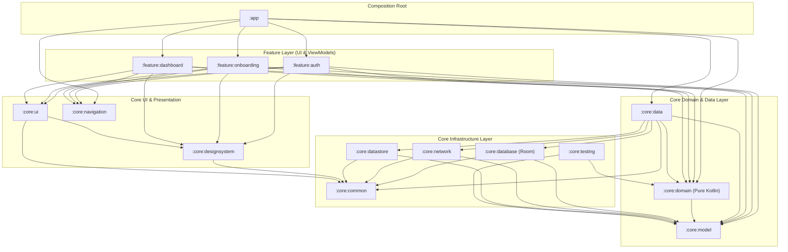

# Android Module Architecture

## 1. Architectural Overview
DukaanAI is engineered as a **modular, offline-first native Android application** adhering to **Clean Architecture** and **Unidirectional Data Flow (UDF)** principles.

The codebase is split into modular layers:
- `:app`: The application composition root.
- `:feature:*`: Autonomous, loosely-coupled feature modules representing specific user flows.
- `:core:*`: Shared infrastructure, domain, database, networking, and UI design system modules.
- `:build-logic`: Centralized Gradle convention plugins sharing build configurations.

## 2. Module Dependency Graph



## 3. Strict Architectural Dependency Rules
1. **Feature-to-Feature Isolation**: Feature modules must **never** depend on other feature modules directly. Cross-feature navigation is coordinated via type-safe routes in `:core:navigation` and orchestrated in `:app`.
2. **Pure Domain Independence**: `:core:domain` is a pure Kotlin JVM library (`dukaanai.jvm.library`). It has **zero dependencies on Android SDK classes** (`android.*`).
3. **Repository Inversion**: UI and ViewModels never directly touch Room DAOs, Retrofit interfaces, or DataStore. All data access must pass through repository interfaces defined in `:core:domain` and implemented in `:core:data`.
4. **Single Source of Truth**: The local Room database in `:core:database` is the authoritative source of truth for the offline-first application.

## 4. How to Add a New Feature Module
When introducing a new feature module (e.g. `:feature:pos` or `:feature:khata`):
1. **Register in `settings.gradle.kts`**:
   ```kotlin
   include(":feature:pos")
   ```
2. **Create `build.gradle.kts`**:
   Apply the convention plugin:
   ```kotlin
   plugins {
       id("dukaanai.android.feature")
   }

   android {
       namespace = "ai.dukaan.feature.pos"
   }

   dependencies {
       // Optional additional dependencies
   }
   ```
3. **Add Navigation Route**:
   In `:core:navigation`, add a `@Serializable` destination class/object to `DukaanNavDestination.kt`:
   ```kotlin
   @Serializable
   data object PosRoute : DukaanRoute
   ```
4. **Add to `:app`**:
   Add `implementation(project(":feature:pos"))` in `app/build.gradle.kts` and register the `composable<PosRoute>` destination inside `DukaanApp.kt`.
