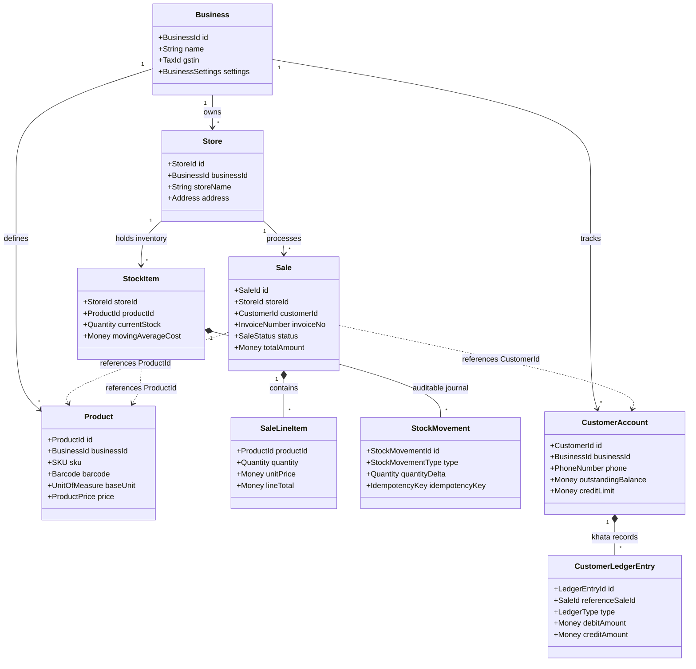
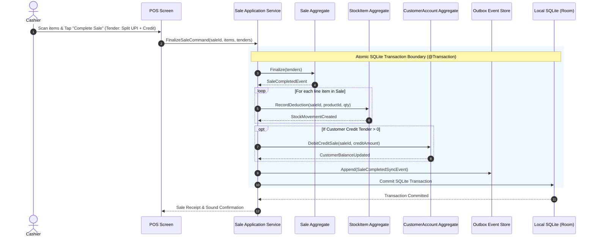

# DukaanAI: Aggregate Design & Consistency Boundaries

This document defines the Aggregate Roots, their internal consistency boundaries, and cross-aggregate coordination mechanics.

---

## 1. Aggregate Design Principles

1. **Protect Business Invariants**: An aggregate is a cluster of domain objects treated as a single unit for data changes. The Aggregate Root is the only member accessible from outside.
2. **Design Small Aggregates**: Avoid "God Aggregates". Never load an entire product catalog, entire customer transaction history, or entire store stock ledger into memory within a single aggregate.
3. **Reference Other Aggregates by ID Only**: Aggregates never hold direct in-memory object references to other aggregate roots. They hold typed identifiers (e.g., `productId: ProductId`, not `val product: Product`).
4. **Immediate Consistency within Aggregate**: Invariants spanning objects inside the same aggregate root are enforced immediately and synchronously.
5. **Eventual or Event-Driven Consistency Across Aggregates**: Invariants spanning multiple aggregates are enforced using domain events or application service coordination.

---

## 2. Core Aggregate Roots Specification

### 2.1 Business Aggregate
- **Root**: `Business`
- **Child Entities**: `BusinessMember`, `StoreAssignment`
- **Value Objects**: `BusinessId`, `TaxIdentificationNumber` (GSTIN), `BusinessSettings`, `Currency`
- **Invariants**: Must maintain at least one active owner. Members cannot be assigned permissions for unowned stores.
- **Transaction Boundary**: Scoped to business configuration updates.

### 2.2 Store Aggregate
- **Root**: `Store`
- **Child Entities**: None (Kept lightweight)
- **Value Objects**: `StoreId`, `BusinessId`, `Address`, `PhoneNumber`, `StoreOperatingStatus`
- **Invariants**: Store must belong to an active Business. Physical address is mandatory.

### 2.3 Product Aggregate (Catalogue)
- **Root**: `Product`
- **Child Entities**: `UnitConversionRule`
- **Value Objects**: `ProductId`, `BusinessId`, `SKU`, `Barcode`, `ProductName`, `UnitOfMeasure` (BaseUnit), `ProductPrice`, `TaxRate`, `ReorderThreshold`
- **Invariants**: Base unit cannot be changed if transactions have already occurred. Barcode must be unique within tenant. Selling price cannot exceed MRP.
- **External References**: Refers to `BusinessId`. Does **not** reference stock or sales.

### 2.4 Sale Aggregate (POS Invoicing)
- **Root**: `Sale`
- **Child Entities**: `SaleLineItem`, `SalePaymentAllocation`, `SaleAdjustment`
- **Value Objects**: `SaleId`, `StoreId`, `BusinessId`, `InvoiceNumber`, `CustomerId?`, `SaleStatus`, `LineItemTotal`, `SaleTaxBreakdown`, `Discount`, `Money`
- **Invariants**:
  - Once `Completed`, the line-item collection is permanently sealed and immutable.
  - $\text{TotalAmount} = \sum (\text{LineItemTotals}) - \text{Discount} + \text{Taxes}$.
  - Sum of payment allocations + credit amount must exactly equal `TotalAmount`.
- **External References**: Refers to `StoreId`, `CustomerId?`, `CashierId`, and lines contain `ProductId` (by ID only).
- **Anti-Pattern Avoidance**: Does **not** decrement stock inside the Sale aggregate. Emits `SaleCompleted` which triggers inventory updates externally.

### 2.5 Purchase Aggregate (Procurement)
- **Root**: `Purchase`
- **Child Entities**: `PurchaseLineItem`, `PurchasePaymentRecord`
- **Value Objects**: `PurchaseId`, `StoreId`, `BusinessId`, `SupplierId`, `PurchaseStatus`, `PurchaseUnitCost`, `PurchaseTaxBreakdown`
- **Invariants**: Items cannot be received before the bill is validated. Unit cost must be non-negative.
- **External References**: Refers to `SupplierId`, `StoreId`, and lines contain `ProductId`.

### 2.6 StockItem Aggregate (Inventory Boundary)
- **Root**: `StockItem` (Partitioned by `(StoreId, ProductId)`)
- **Child Entities**: `StockMovementJournalEntry` (Only recent un-checkpointed window loaded in memory)
- **Value Objects**: `StockMovementId`, `StockMovementType`, `QuantityDelta`, `BaseQuantity`, `CurrentBalance`
- **Invariants**:
  - Current balance must equal initial checkpoint balance plus sum of subsequent valid journal entries.
  - Movements with duplicate `idempotencyKey` are discarded without modifying balance.
- **External References**: Scoped by `StoreId` and `ProductId`.

### 2.7 CustomerAccount Aggregate (Khata Ledger)
- **Root**: `CustomerAccount`
- **Child Entities**: `CustomerLedgerEntry` (Recent window / checkpointed balance)
- **Value Objects**: `CustomerId`, `BusinessId`, `PhoneNumber`, `CreditLimit`, `CustomerBalance` (Current outstanding)
- **Invariants**:
  - Repayments (*Jama*) cannot exceed the allowable advance threshold.
  - Balance must reflect exact algebraic sum of credit sales (debits) and repayments (credits).
- **External References**: Scoped by `BusinessId`. Referenced transactions store `SaleId?`.

### 2.8 SupplierAccount Aggregate
- **Root**: `SupplierAccount`
- **Child Entities**: `SupplierLedgerEntry`
- **Value Objects**: `SupplierId`, `BusinessId`, `SupplierPayableBalance`
- **Invariants**: Payable balance matches inward purchase liabilities minus supplier settlements.

### 2.9 Expense Aggregate
- **Root**: `Expense`
- **Child Entities**: None (Lightweight standalone transaction)
- **Value Objects**: `ExpenseId`, `StoreId`, `BusinessId`, `ExpenseCategory`, `Money`, `PaymentMethod`, `ExpenseRecipient`
- **Invariants**: Expense amount must be strictly positive ($> 0$). Must specify a recognized category.

---

## 3. Aggregate Relationship Diagram

---

## 4. Multi-Product Sale Coordination Sequence (Avoiding Distributed Transactions)

A fundamental challenge in retail software is: *How does a single counter sale containing 10 different products deduct inventory across 10 items, record customer credit, and register cash drawer collections without brittle distributed transactions?*

### 4.1 On Android (Offline Execution)
Because Android uses local SQLite (Room), all operations occur within a **single local ACID database transaction**:

### 4.2 On Backend (Cloud Sync & REST API)
When the client synchronizes an offline batch or submits an online counter sale, the backend processes it within an atomic PostgreSQL transaction scoped by tenant:
1. Validates that `idempotency_key` has not been processed.
2. Commits the `Sale` record.
3. Appends rows to the `stock_movement_journal` for each item.
4. Appends a debit row to `customer_ledger`.
5. Emits integration events to the Message Outbox table for Business Intelligence consumption.
6. Commits database transaction.

No two-phase commit (2PC) or distributed transactions are required.
