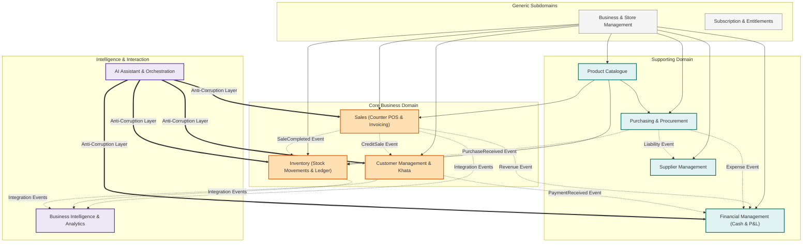
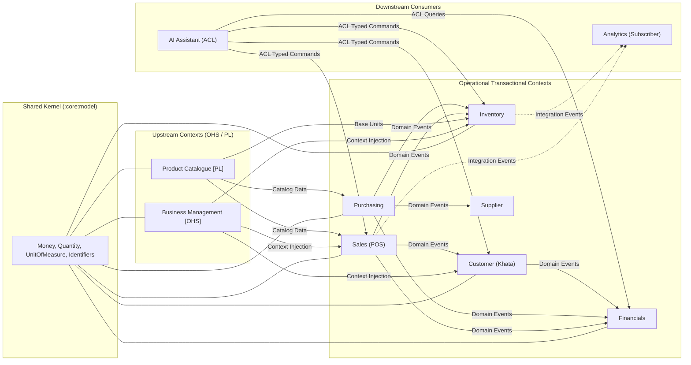

# DukaanAI: Strategic Context Map

This document defines the strategic boundaries and relationship patterns between bounded contexts in DukaanAI.

---

## 1. Strategic Domain Map & Relationship Patterns

In a modular monolith, bounded contexts represent strictly separated logical modules within the same deployable codebase. Relationships between contexts are governed by explicit Strategic DDD integration patterns:

| Upstream Context | Downstream Context | Pattern | Justification & Mechanism |
|---|---|---|---|
| **Business Management** | All Contexts | **Open Host Service (OHS) / Published Language (PL)** | Business, Store, and Tenant identities are universal. Published as immutable value objects (`BusinessId`, `StoreId`, `TenantContext`). |
| **Product Catalogue** | **Sales** | **Customer / Supplier (Downstream Customer)** | Sales relies on Product definitions and unit conversions. Changes in Product Catalogue must satisfy Sales billing needs. |
| **Product Catalogue** | **Inventory** | **Conformist** | Inventory conforms to the `ProductId` and `BaseUnit` defined by the Product Catalogue. |
| **Sales** | **Inventory** | **Customer / Supplier via Domain Events** | Asynchronous decoupled integration. `SaleCompleted` triggers stock deduction in Inventory. |
| **Sales** | **Customer Management** | **Customer / Supplier via Domain Events** | Credit sales emit `SaleCompleted(tender=Credit)` which downstream Customer Management consumes to debit the customer's khata. |
| **Purchasing** | **Inventory** | **Customer / Supplier via Domain Events** | `PurchaseReceived` triggers inward stock movement creation in Inventory. |
| **Purchasing** | **Supplier Management** | **Customer / Supplier via Domain Events** | `PurchaseReceived` triggers payable liability updates in Supplier Management. |
| **Sales, Purchasing, Customer, Expense** | **Financial Management** | **Published Language (Event Aggregator)** | Financial Management aggregates domain events from operational contexts into P&L and Cash Flow ledgers. |
| **Operational Contexts** | **Business Intelligence** | **Open Host Service / Asynchronous Projection** | Read-only reporting projections listening to integration events without coupling to transaction paths. |
| **AI Assistant** | **Operational Services** | **Anti-Corruption Layer (ACL)** | The AI Assistant maps untrusted natural language utterances into strongly typed Domain Command DTOs through an ACL. |
| **Shared Value Objects** | **Core Modules** | **Shared Kernel (SK)** | Core primitive value objects (`Money`, `Quantity`, `UnitOfMeasure`, `TenantId`) are maintained in a clean, immutable Shared Kernel (`:core:model`). |

---

## 2. Bounded Context Architecture Diagram

---

## 3. Context Map Integration Matrix

---

## 4. Cross-Context Consistency & Transaction Boundaries

In DukaanAI's modular monolith:
1. **Intra-Aggregate Consistency**: Strictly immediate and ACID. An aggregate boundary is locked and committed in a single atomic database transaction.
2. **Inter-Aggregate Consistency within Same Context**: Achieved within the same atomic database transaction when business invariants require it (e.g., closing a `CashRegisterSession` and persisting final discrepancy).
3. **Cross-Context Coordination (e.g., Sale -> Inventory -> Khata)**:
   - On **Android (Offline)**: All local updates (Sale record, local Stock movement entry, Customer Khata entry, and Outbox sync record) are executed in a single atomic SQLite transaction using Room's `@Transaction` semantics. This guarantees zero partial writes on the device.
   - On **Backend (Cloud Sync / API)**: Handled idempotently using an Outbox / Transactional Event Publisher. When a `SaleCompleted` event is processed, idempotency keys ensure downstream inventory movements and customer ledger debits cannot be duplicated even under retry conditions.
