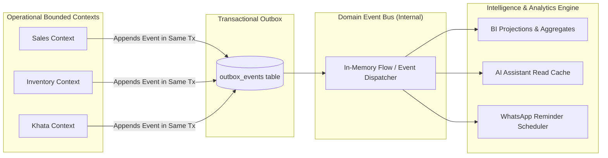

# DukaanAI: Domain Events Catalogue

This document defines the formal domain events emitted by aggregates across DukaanAI, their envelopes, payloads, and consumption patterns.

---

## 1. Domain Events vs. Integration Events

DukaanAI maintains a strict architectural distinction between **Domain Events** and **Integration Events**:

| Dimension | Domain Event | Integration Event |
|---|---|---|
| **Scope** | Internal to the Bounded Context and aggregate boundary. | Shared across bounded contexts and with external subsystems (Analytics, Sync Engine, Notifications). |
| **Payload** | Rich domain objects, entity references, and business contextual metadata. | Flattened, schema-versioned DTOs with minimal primitives (UUIDs, ISO-8601 strings, Decimal strings). |
| **Delivery** | Synchronous or in-process asynchronous dispatch within the same database transaction. | Asynchronous published language via Transactional Outbox pattern and message queues. |
| **Coupling** | Strongly coupled to domain model semantics. | Loosely coupled; changes require backward-compatible versioning. |

---

## 2. Standard Domain Event Envelope

Every domain event in DukaanAI conforms to the standard event envelope:

```kotlin
interface DomainEvent {
    val eventId: UUID             // Globally unique event identifier
    val businessId: BusinessId    // Mandatory tenant isolation partition
    val storeId: StoreId?         // Store partition, if store-scoped
    val aggregateId: UUID         // Identity of the originating aggregate root
    val aggregateType: String     // e.g., "Sale", "StockItem", "CustomerAccount"
    val eventType: String         // Dot-notated domain event name
    val occurredAt: Instant       // Timestamp of real-world business occurrence
    val version: Int              // Schema version (e.g., 1)
}
```

---

## 3. Core Domain Event Catalogue

### 3.1 Business Management Context

| Event Name | Aggregate Root | Triggering Action | Key Payload Attributes |
|---|---|---|---|
| `business.registered.v1` | `Business` | Merchant registers new business account | `businessId`, `name`, `ownerId`, `currency`, `gstin?` |
| `store.created.v1` | `Business` | New branch / store added | `businessId`, `storeId`, `storeName`, `address`, `phone` |
| `store.settings.updated.v1` | `Business` | Store operating preferences updated | `businessId`, `storeId`, `settingsMap` |

### 3.2 Product Catalogue Context

| Event Name | Aggregate Root | Triggering Action | Key Payload Attributes |
|---|---|---|---|
| `catalogue.product.created.v1` | `Product` | New master product SKU created | `productId`, `sku`, `name`, `category`, `barcode?`, `baseUnit`, `sellingPrice`, `mrp` |
| `catalogue.product.price_changed.v1` | `Product` | Merchant updates selling price | `productId`, `oldPrice`, `newPrice`, `reason`, `changedBy` |
| `catalogue.product.barcode_linked.v1` | `Product` | Barcode attached to product | `productId`, `barcode` |
| `catalogue.unit_conversion.defined.v1`| `Product` | Conversion rule added | `productId`, `fromUnit`, `toUnit`, `multiplier` |

### 3.3 Sales & POS Context

| Event Name | Aggregate Root | Triggering Action | Key Payload Attributes |
|---|---|---|---|
| `sales.sale.completed.v1` | `Sale` | Counter checkout finalized | `saleId`, `storeId`, `invoiceNumber`, `customerId?`, `lineItems: List<SaleLineItemPayload>`, `totalAmount`, `paidAmount`, `creditAmount`, `tenderBreakdown` |
| `sales.sale.payment_allocated.v1` | `Sale` | Payment applied to bill | `saleId`, `paymentId`, `amount`, `paymentMethod`, `reference?` |
| `sales.sale.voided.v1` | `Sale` | Cashier voids sale | `saleId`, `storeId`, `reason`, `authorizedBy` |
| `sales.sale.returned.v1` | `Sale` | Customer returns items | `saleId`, `returnId`, `returnedItems: List<ReturnItemPayload>`, `refundAmount`, `refundMethod` |

### 3.4 Purchasing Context

| Event Name | Aggregate Root | Triggering Action | Key Payload Attributes |
|---|---|---|---|
| `purchasing.purchase.received.v1` | `Purchase` | Inward distributor stock received | `purchaseId`, `storeId`, `supplierId`, `supplierInvoiceNo`, `items: List<PurchaseItemPayload>`, `totalCost`, `taxAmount` |
| `purchasing.purchase.payment_recorded.v1`| `Purchase` | Payment made to distributor | `purchaseId`, `amount`, `paymentMethod`, `paymentReference` |
| `purchasing.purchase.returned.v1` | `Purchase` | Rejected goods returned to vendor | `purchaseId`, `returnId`, `debitNoteNo`, `items`, `debitAmount` |

### 3.5 Inventory Context

| Event Name | Aggregate Root | Triggering Action | Key Payload Attributes |
|---|---|---|---|
| `inventory.stock.movement_recorded.v1` | `StockItem` | Any stock change committed | `movementId`, `storeId`, `productId`, `movementType`, `quantityDelta`, `balanceAfter`, `referenceId`, `idempotencyKey` |
| `inventory.stock.low_threshold_breached.v1`| `StockItem` | Stock drops below threshold | `storeId`, `productId`, `currentStock`, `reorderThreshold` |
| `inventory.stock.audited.v1` | `StockItem` | Physical count adjustment | `storeId`, `productId`, `systemStock`, `countedStock`, `varianceQuantity`, `reason`, `auditorId` |
| `inventory.stock.damaged_recorded.v1` | `StockItem` | Spoilage / damage logged | `storeId`, `productId`, `damagedQuantity`, `reason` |

### 3.6 Customer Management & Khata Context

| Event Name | Aggregate Root | Triggering Action | Key Payload Attributes |
|---|---|---|---|
| `customer.registered.v1` | `CustomerAccount` | New customer profile created | `customerId`, `name`, `phoneNumber`, `creditLimit?` |
| `customer.credit.debited.v1` | `CustomerAccount` | Credit sale added to khata | `customerId`, `saleId`, `amount`, `newOutstandingBalance` |
| `customer.payment.received.v1` | `CustomerAccount` | Cash/UPI repayment (*Jama*) | `customerId`, `paymentId`, `amount`, `newOutstandingBalance`, `paymentMethod` |
| `customer.credit_limit.exceeded.v1`| `CustomerAccount` | Khata crosses credit limit | `customerId`, `currentBalance`, `creditLimit` |

### 3.7 Financial Management Context

| Event Name | Aggregate Root | Triggering Action | Key Payload Attributes |
|---|---|---|---|
| `finance.register.opened.v1` | `CashRegister` | Morning till opened | `sessionId`, `storeId`, `openingFloat`, `cashierId` |
| `finance.register.closed.v1` | `CashRegister` | Evening till closed | `sessionId`, `storeId`, `expectedCash`, `actualCash`, `variance`, `closingNotes` |
| `finance.expense.recorded.v1` | `Expense` | Petty cash or shop expense | `expenseId`, `storeId`, `category`, `amount`, `paymentMethod`, `recipientName`, `notes` |

---

## 4. Downstream Intelligence Engine Decoupling

The **Business Intelligence (BI)** and **AI Assistant** engines never directly query operational tables or bind to private aggregate states. Instead, they consume integration events via an **Outbox Event Publisher**:



### Benefits of this Event-Driven Decoupling:
1. **Zero Locking on Operational Path**: The checkout counter never waits for analytics recalculations or BI indexes to update.
2. **Schema Evolution Resilience**: If the internal `Sale` aggregate changes internal fields, the integration event contract (`sales.sale.completed.v1`) remains unchanged.
3. **Replayability**: If analytical metrics need recalculation or a new AI model feature is deployed, historical events can be replayed from the event store.
