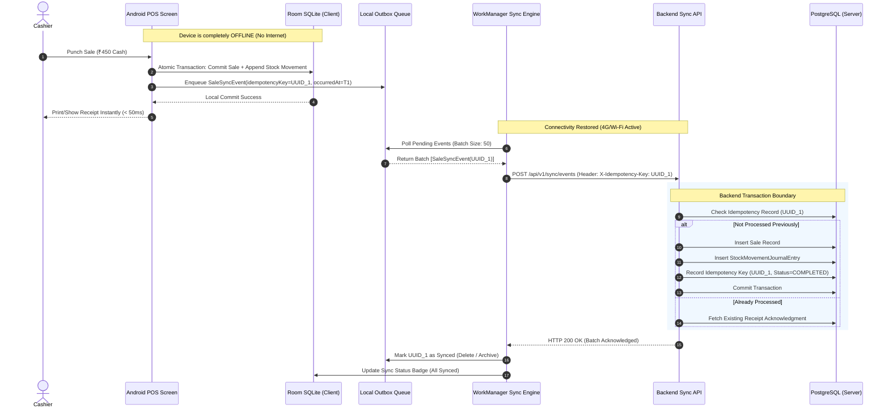

# DukaanAI: Offline-First Domain Consistency & Synchronization

Kirana stores operate in environments with erratic 4G/2G mobile connectivity, Wi-Fi dead zones, and frequent power outages. An application that blocks counter billing when the cloud is unreachable is completely unacceptable in this retail sector.

This document establishes the domain-level consistency strategy, timestamp ontology, conflict resolution rules, and synchronization protocol.

---

## 1. Core Synchronization Invariants

1. **Local Autonomy**: Counter sales, customer khata recordings, and physical stock deductions must commit locally with 100% operational fidelity without requiring a network round-trip.
2. **Never Last-Write-Wins (LWW) for Financials**: LWW silently overwrites customer balances and ledger credits. Financial and inventory transactions are **strictly append-only and commutative**.
3. **Idempotency by Design**: Every mutating client request carries an immutable client-generated UUID (`idempotency_key`). Repeated deliveries due to network retries cannot duplicate transactions.
4. **Partitioned Invariant Enforcement**:
   - **Locally Guaranteed Invariants**: Line item totals, tender balance match, local stock deductions, and customer credit ledger updates.
   - **Server-Revalidated Invariants**: Global tenant subscription limits, centralized multi-store SKU changes, and cross-device credit limit reconciliation.

---

## 2. Three-Tier Timestamp Ontology

To resolve out-of-order event arrivals without corrupting audit timelines, DukaanAI explicitly tracks three distinct timestamps on every transaction:

| Timestamp Attribute | System Source | Business Meaning & Usage |
|---|---|---|
| `occurredAt` | Client Clock (NTP-synchronized or device local) | The **real-world physical occurrence time** when goods were handed to the customer. Used for historical ledger ordering and daily sales reporting. |
| `clientCreatedAt` | Client Monotonic Clock | The local software creation timestamp on the mobile device. Used to sequence local outbox events. |
| `serverIngestedAt` | Cloud Server Clock (UTC) | The authoritative timestamp when the cloud backend received and committed the event. Used for cloud auditing and replication ordering. |

---

## 3. Conflict Resolution & Commutative Ledgers

### 3.1 Financial Transactions (No Conflicts)
Because financial ledgers (Sales, Customer Khata, Supplier Accounts) use double-entry append-only journals, **concurrent transactions never conflict**:
- Staff Member A records a ₹200 cash sale on Device 1.
- Staff Member B records a ₹500 credit sale on Device 2.
- Upon reconnection, both records are appended to the cloud journal. Total sales revenue evaluates to ₹700 without conflict.

### 3.2 Inventory Concurrency (Commutative Quantities)
Stock movements are additive deltas:
$$\Delta_{\text{total}} = \Delta_{\text{Device1}} + \Delta_{\text{Device2}}$$
If Device 1 sells 2 packets of tea (-2) and Device 2 sells 3 packets of tea (-3), the cloud ledger records both movements sequentially, resulting in an exact -5 reduction.

### 3.3 Stale Product Prices at Offline Counter
If the store owner updates the master price of a biscuit packet from ₹20 to ₹22 on the backend while Device 2 is offline:
- Device 2 continues selling the biscuit packet at the local cached price of ₹20.
- **Business Rule**: The customer was physically billed at ₹20 and paid ₹20. The server **honors the sale price recorded on the receipt** as authoritative for that specific transaction.
- When Device 2 reconnects, it syncs the sale at ₹20, and simultaneously downloads the updated catalog master price (₹22) for subsequent sales.

---

## 4. Offline Synchronization Sequence Diagram

---

## 5. Failure Recovery & Duplicate Delivery Matrix

| Failure Mode | Point of Failure | System Behavior & Self-Healing |
|---|---|---|
| **Power Loss During Sale Punch** | Android Device | SQLite transaction rolls back completely. Zero partial writes. Cashier re-punches sale upon reboot. |
| **Network Drop During Sync Push** | Client-to-Server HTTP Request | Client `WorkManager` retries with exponential backoff using the identical `idempotencyKey`. |
| **Server Crash After Write, Before Ack** | Server-to-Client Response Drop | Client retries. Server detects existing `idempotencyKey` in database, skips re-insertion, and re-transmits HTTP 200 OK. |
| **Device Clock Skew (Incorrect Date/Time)** | Client Hardware Clock | Client uses monotonic system elapsed time to sequence events. Server records `serverIngestedAt` to detect anomalous device time drift. |
| **Deleted / Inactive Product Sold Offline** | Client Catalog Cache Stale | If a deactivated product was sold offline, the server accepts the transaction for financial integrity, but flags a reconciliation notice in the merchant dashboard. |
