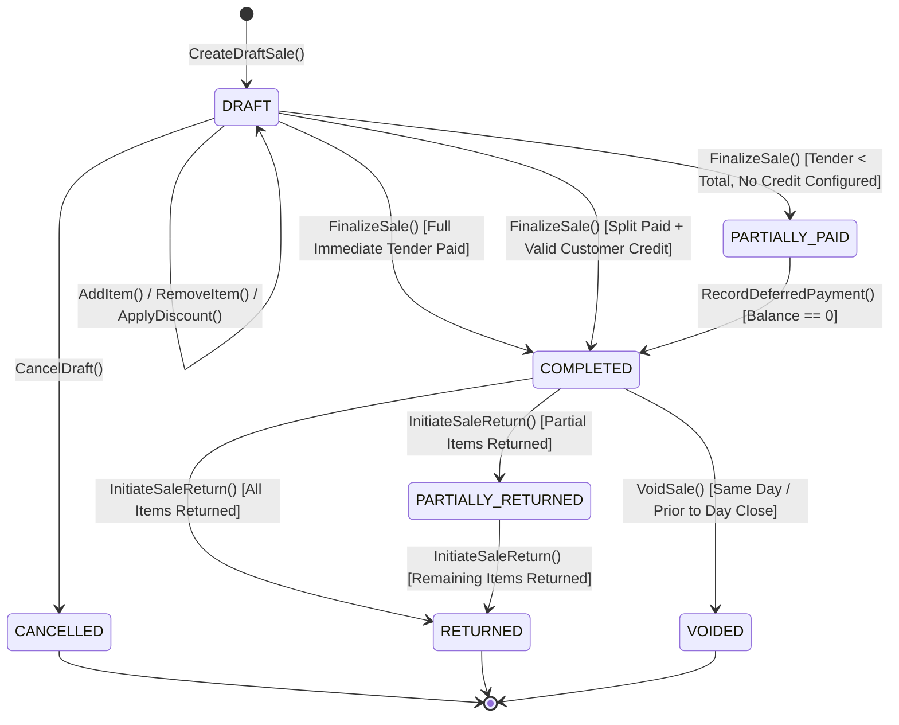
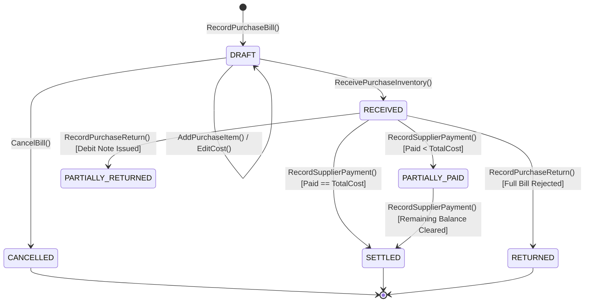
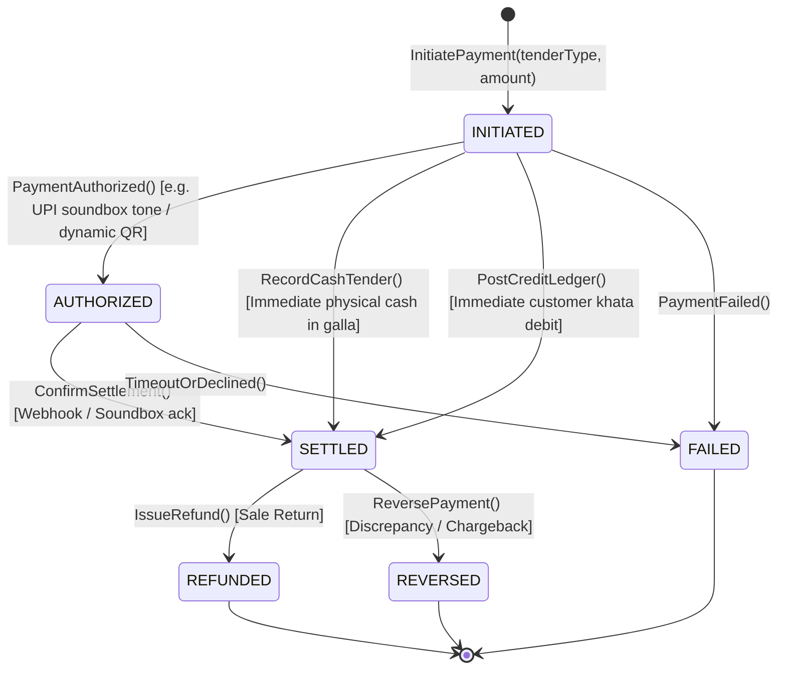
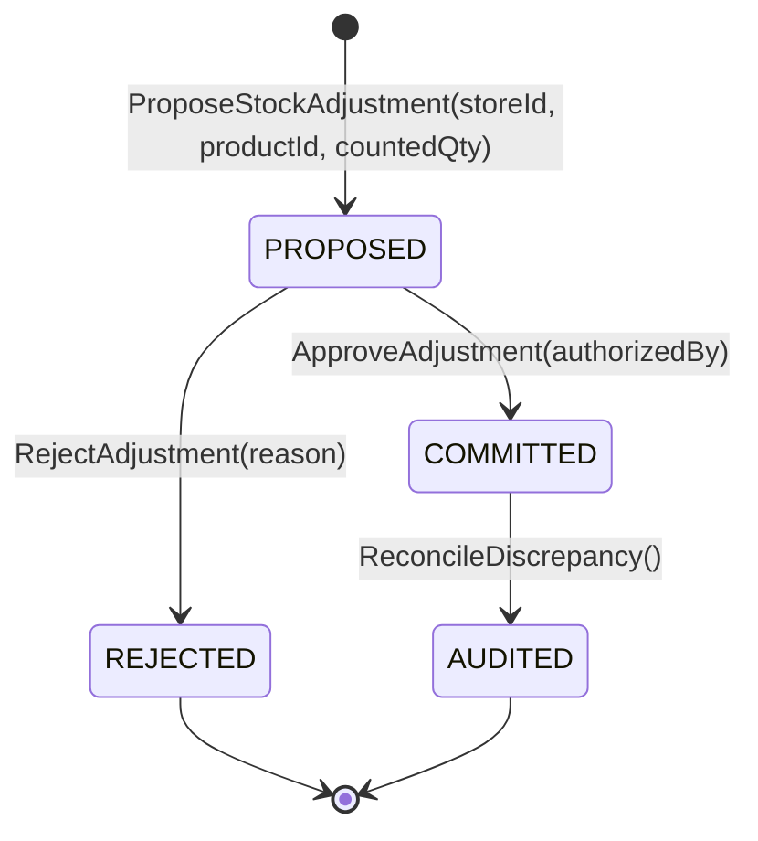
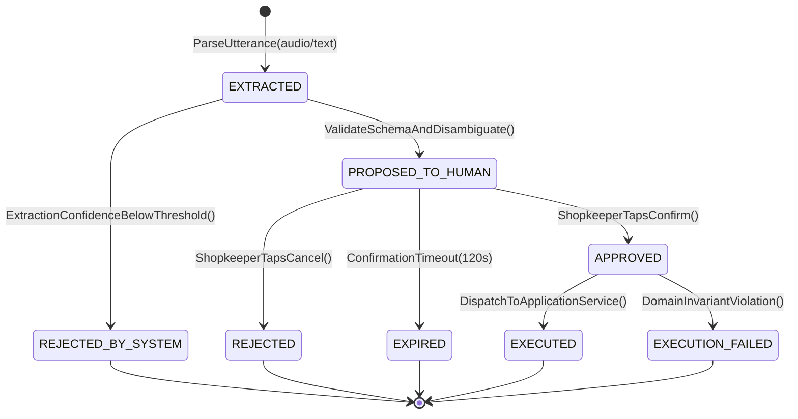

# DukaanAI: State Machines & Lifecycle Transitions

This document defines the formal state machines, transition rules, preconditions, and invariants governing key domain entity lifecycles in DukaanAI.

---

## 1. Sale Lifecycle State Machine

A counter sale progresses from drafting to completion and potential reversal.

### Transition Specifications:

| Initial State | Command | Preconditions | Resulting State | Events Emitted | Rejected Transitions & Reason |
|---|---|---|---|---|---|
| `[*]"` | `CreateDraftSale` | Valid `storeId` & `cashierId`. | `DRAFT` | `SaleDraftCreated` | Cannot create for deactivated store. |
| `DRAFT` | `FinalizeSale` | At least 1 valid line item; Payments + Credit == TotalAmount. | `COMPLETED` | `SaleCompleted`, `StockDeductionRequested`, `CustomerCreditDebited?` | Rejected if total != allocated tenders. |
| `DRAFT` | `CancelDraft` | None. | `CANCELLED` | `SaleDraftCancelled` | No stock or financial impact. |
| `COMPLETED` | `InitiateSaleReturn` | Return quantity $\le$ original sold quantity; return window active. | `PARTIALLY_RETURNED` or `RETURNED` | `SaleReturned`, `StockReturnRestored`, `RefundIssued` | Rejected if returning more than sold. |
| `COMPLETED` | `VoidSale` | Register session not yet locked; explicit void reason provided. | `VOIDED` | `SaleVoided`, `StockDeductionReversed` | Cannot void an already returned sale. |
| `VOIDED` / `RETURNED` | Any Mutating Command | None (Terminal States). | Rejected | None | **Terminal states are permanently locked.** |

---

## 2. Purchase Lifecycle State Machine

Governs distributor procurement from billing to inward receipt and payment settlement.

### Transition Specifications:

| Initial State | Command | Preconditions | Resulting State | Events Emitted | Invariants & Notes |
|---|---|---|---|---|---|
| `[*]"` | `RecordPurchaseBill` | Valid `supplierId`, invoice number, and store. | `DRAFT` | `PurchaseDraftRecorded` | Line items can be adjusted before receipt. |
| `DRAFT` | `ReceivePurchaseInventory` | At least 1 item; unit costs $\ge 0$. | `RECEIVED` | `PurchaseReceived`, `StockAdditionRequested`, `SupplierLiabilityPosted` | **Inventory additions trigger only upon transitioning to `RECEIVED`.** |
| `RECEIVED` | `RecordSupplierPayment` | Payment amount $\le$ unpaid bill balance. | `PARTIALLY_PAID` or `SETTLED` | `PurchasePaymentRecorded`, `SupplierLiabilityReduced` | Cash / Bank account balance reduces accordingly. |
| `RECEIVED` | `RecordPurchaseReturn` | Returned quantity $\le$ received quantity; debit note generated. | `PARTIALLY_RETURNED` or `RETURNED` | `PurchaseReturned`, `StockOutwardRecorded`, `DebitNoteCreated` | Reduces inventory and decreases supplier payable liability. |

---

## 3. Payment Lifecycle State Machine

Models individual monetary tender flows across Cash, UPI, and Digital Khata.

### Transition Specifications:
- `SETTLED`: Monetary value is recognized in the financial register.
- `REFUNDED`: Compensating reversal tender issued with identical payment method where possible.
- `REVERSED`: Audit correction voiding a fraudulent or duplicated transaction.

---

## 4. Inventory Adjustment Lifecycle State Machine

Controls physical stock reconciliation, damage write-offs, and audit corrections.

### Transition Specifications:
- `PROPOSED`: Draft adjustment created during count. System computes variance: $\Delta = \text{Counted} - \text{SystemBalance}$. No stock balance change occurs.
- `COMMITTED`: Authorized by store owner/manager. Generates an `AUDIT_ADJUSTMENT` movement entry in `StockMovementJournal`.
- `AUDITED`: Finalized reconciliation report archived for tax and inventory accounting.

---

## 5. AI Action Approval & Execution Lifecycle

Enforces human-in-the-loop safety for voice and conversational transactions.

### Transition Specifications:
- `EXTRACTED`: LLM parses Hinglish voice utterance into candidate JSON tokens.
- `PROPOSED_TO_HUMAN`: Application layer verifies product/customer disambiguation and presents a high-contrast confirmation card on screen.
- `APPROVED`: Shopkeeper explicitly taps "Confirm".
- `EXECUTED`: Target domain application service (`RecordSale`, `RecordExpense`, `RecordCredit`) executes with deterministic business rules.
- `EXECUTION_FAILED`: If the domain rejects the command (e.g., negative money, missing mandatory field), the failure is reported to the user with a specific business explanation.
