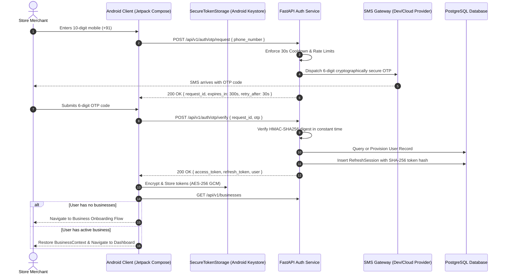
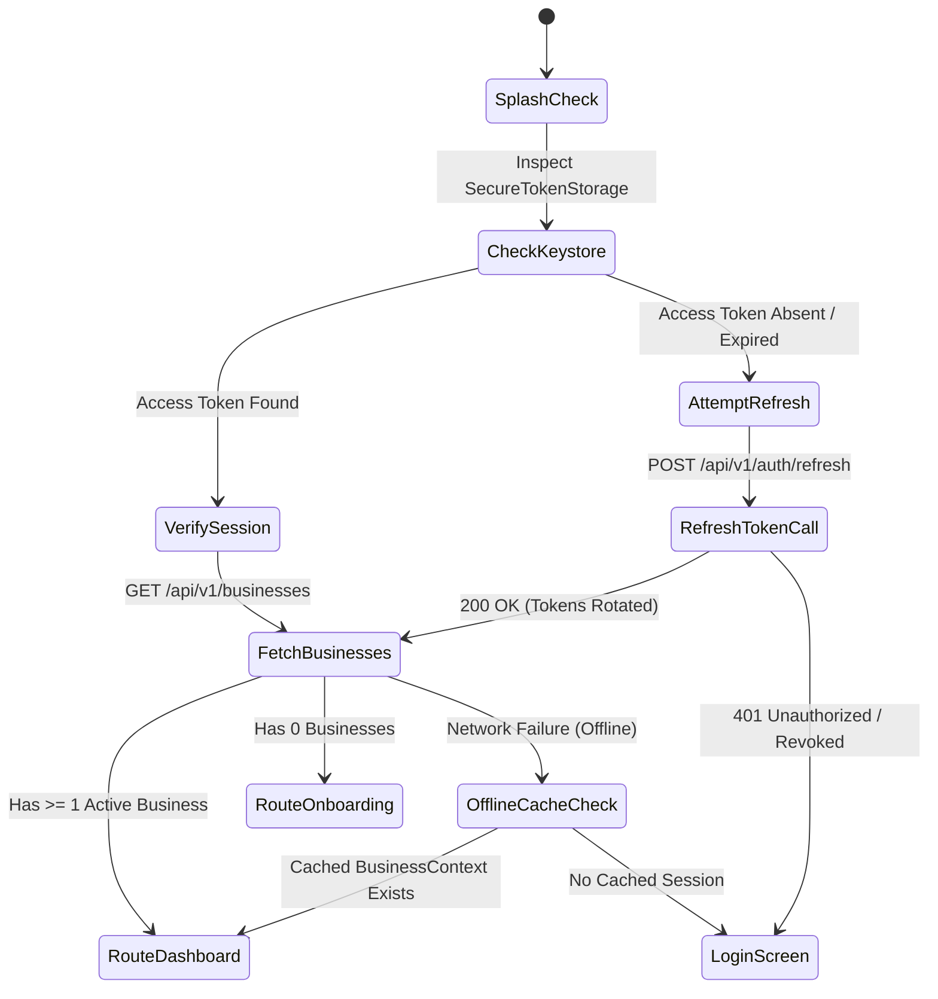

# DukaanAI — Authentication Flow Architecture

## 1. Overview
DukaanAI employs a passwordless, phone-first OTP authentication protocol tailored for Indian kirana and small retail merchants. The flow eliminates credential friction while ensuring cryptographic security, session revocability, and tenant scoping.

---

## 2. End-to-End Sequence Diagram

---

## 3. Client-Side Lifecycle & Session Restoration

---

## 4. Key Security Invariants
1. **Never Log Sensitive Data:** Phone numbers are masked (`+91 98765*****`), OTPs and tokens are strictly excluded from structured logs and interceptors.
2. **Single-Flight Authenticator Mutex:** When access tokens expire, concurrent API requests queue on an in-memory Mutex in `TokenAuthenticator`. Only one refresh request executes; subsequent requests replay with the rotated token without infinite 401 loops.
3. **Replay Attack Elimination:** OTP codes are purged from server-side memory immediately upon successful verification.
