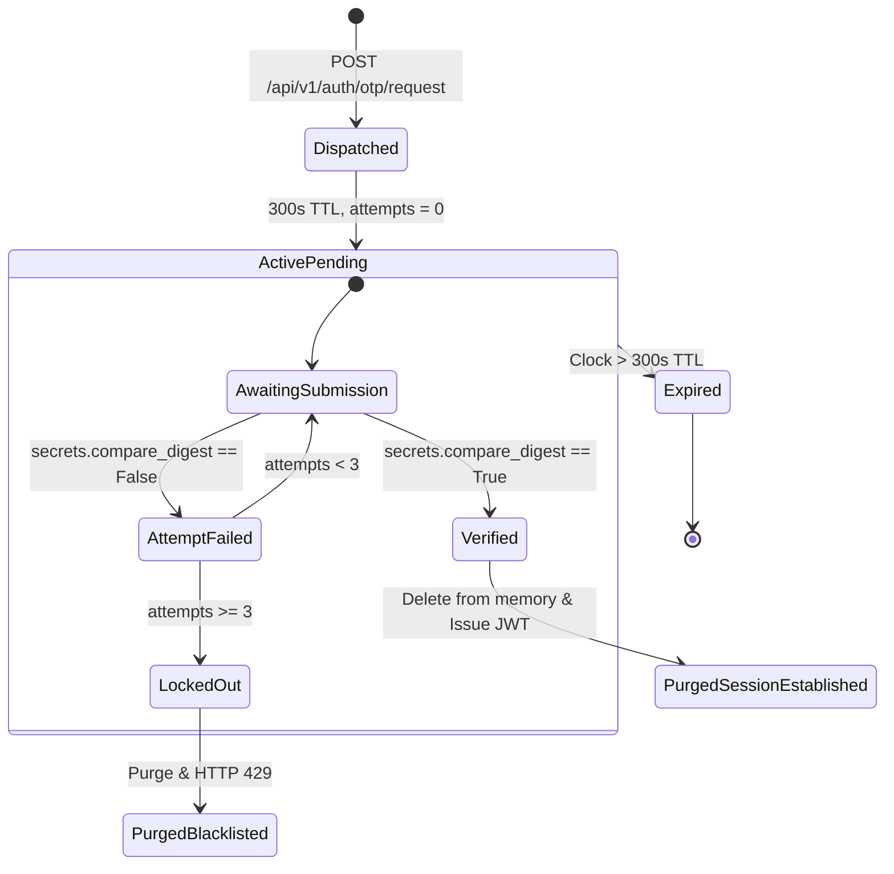

# DukaanAI — OTP Security & Cryptographic Invariants

## 1. Threat Model & Mitigations
Mobile OTPs in Indian retail are susceptible to brute-force attacks, replay attempts, SMS interception, and denial-of-service spamming. DukaanAI implements enterprise-grade cryptographic guarantees to neutralize these threats.

---

## 2. Security Invariants Table

| Threat Vector | Mitigation Strategy | Implementation Details |
| :--- | :--- | :--- |
| **Brute Force Enumeration** | Strict Attempt Threshold | Maximum 3 attempts allowed per OTP window. Code is instantly purged upon 3rd failed attempt (`OTPMaxAttemptsExceeded`, HTTP 429). |
| **Replay Attacks** | Immediate Single-Use Purge | Verified OTP records are wiped from memory immediately upon match. Subsequent submissions fail with `InvalidOTP`. |
| **Timing Attacks** | Constant-Time Digest Verification | Submissions are verified using `secrets.compare_digest(record.hashed_otp, expected_hash)`. |
| **Memory Extraction** | Salted Hash Storage | OTPs are NEVER stored in plaintext. Stored record = `HMAC-SHA256(phone + plain_otp, SECRET_KEY)`. |
| **SMS Flooding / Cost Exhaustion** | Cooldown & Expiration Windows | 30-second cooldown between requests per phone. Total validity lifetime is 300 seconds (5 minutes). |
| **Input Ambiguity / Phishing** | Request ID Scoping | Each dispatch yields a unique UUIDv4 `request_id`. Verification requires matching `request_id` or normalized E.164 phone. |

---

## 3. Cryptographic State Machine

---

## 4. Phone Number Normalization
All inputs undergo deterministic E.164 normalization before processing:
- Strips non-digits, whitespace, hyphens, and parentheses.
- Strips leading `0` or country code `91` when 12 digits are supplied.
- Validates 10-digit Indian mobile range starting with `6`, `7`, `8`, or `9`.
- Formats authoritative internal identifier as `+91XXXXXXXXXX`.
