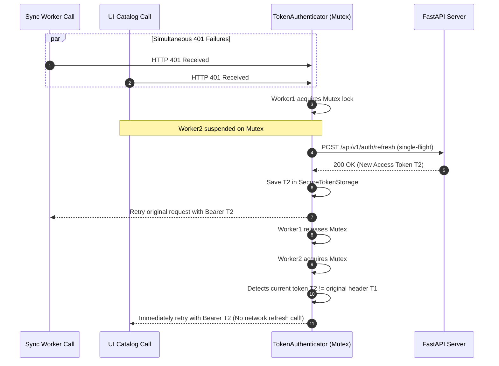

# DukaanAI — Session Management & Mutex Authenticator

## 1. Single-Flight Token Authenticator

In a reactive Android application with concurrent coroutines, multiple network requests can hit an expired access token (HTTP 401) at the exact same moment. Without synchronization, this creates a **refresh stampede**, resulting in multiple refresh calls, session race conditions, and accidental logout.

DukaanAI implements `TokenAuthenticator` (OkHttp `Authenticator`) with a Kotlin Coroutines `Mutex` lock to serialize token refresh.

---

## 2. Session Revocation & Logout
When merchant logs out or session is terminated:
1. `POST /api/v1/auth/logout` revokes the refresh session in PostgreSQL.
2. `SecureTokenStorage.clearTokens()` wipes access and refresh tokens from Android KeyStore.
3. `UserPreferencesDataSource.clearSession()` wipes active tenant and store context.
4. Navigation resets back to `LoginRoute`.
