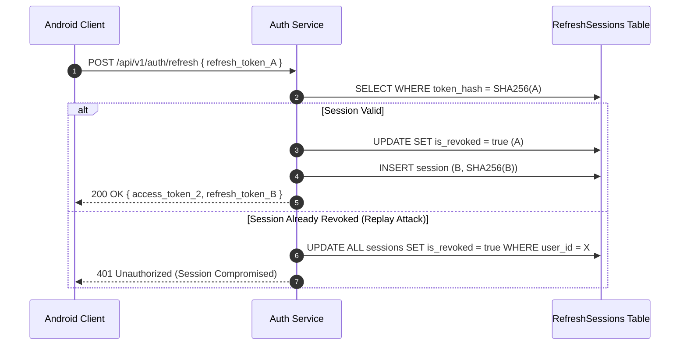
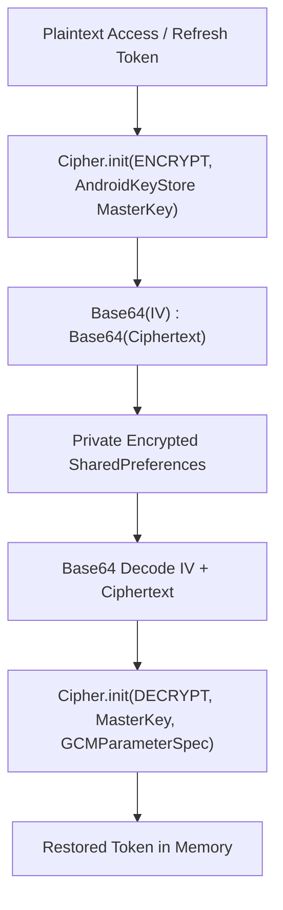

# DukaanAI — Token Management & Keystore Encryption

## 1. Token Hierarchy & Lifetime

DukaanAI utilizes a dual-token asymmetric lifecycle:
1. **Access Token (Short-Lived):**
   - Standard: Signed JWT (HS256)
   - Lifetime: 15 minutes (`ACCESS_TOKEN_EXPIRE_MINUTES = 15`)
   - Claims: `sub` (User UUID), `type` ("access"), `exp`, `iat`
2. **Refresh Token (Long-Lived, Rotating):**
   - Standard: 256-bit cryptographically secure random token (`secrets.token_urlsafe(32)`)
   - Lifetime: 30 days (`REFRESH_TOKEN_EXPIRE_DAYS = 30`)
   - Persistence: Server stores `SHA-256(refresh_token)` in `refresh_sessions` table.

---

## 2. Refresh Token Rotation (RTR)
Every call to `POST /api/v1/auth/refresh`:
- Validates that the submitted token exists, matches `token_hash`, and is not expired or revoked.
- Atomically marks the prior session `is_revoked = True`.
- Generates a completely new refresh token and access token pair.
- Detects token reuse: if a revoked refresh token is submitted, all active sessions for that user are immediately flagged and revoked (compromise defense).

---

## 3. Android Keystore Hardware Encryption

Tokens are never written in plaintext to disk, SharedPreferences, or DataStore.
- **Master Key:** Stored inside Android KeyStore (`DukaanMasterKey`), generated via `KeyGenParameterSpec` with AES-256 in GCM mode without padding.
- **Storage Format:** Ciphertext and 12-byte initialization vector (IV) are encoded as `Base64(IV):Base64(Ciphertext)` and written to isolated private preferences.
- **Hardware Backed:** Backed by Secure Element (SE) / StrongBox / ARM TrustZone on supported modern Android hardware.

