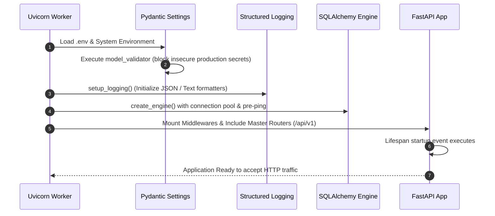
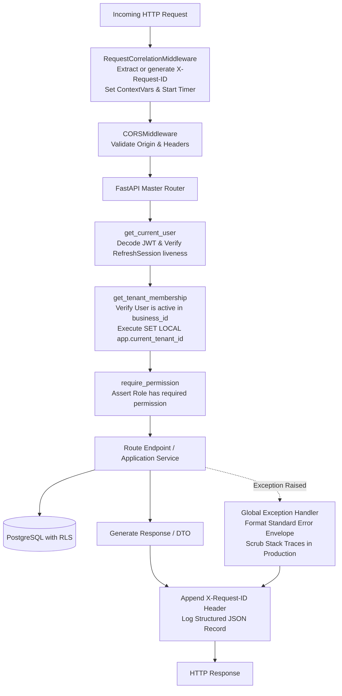

# DukaanAI — Application Lifecycle & Request Processing

## 1. Application Startup Sequence

### Startup Safety Validations:
- In `production`, `Settings.validate_production_settings()` strictly enforces that `JWT_SECRET_KEY` is not default and $\ge 32$ chars, `OTP_PROVIDER != 'dev'`, and `DEBUG == False`. Any violation aborts startup immediately with a clear error before binding network ports.

---

## 2. Request-Response Lifecycle

Every HTTP request traverses a standardized lifecycle pipeline:

---

## 3. Shutdown Sequence

When receiving `SIGTERM` or `SIGINT` (e.g. during rolling Kubernetes deployment):
1. **Liveness/Readiness Signals**: Stop accepting new traffic on `/ready`.
2. **Grace Period**: Drain inflight HTTP transactions within standard 30-second window.
3. **Connection Pool Disposal**: SQLAlchemy `engine.dispose()` closes all idle and active PostgreSQL pool connections.
4. **Log Flush**: Emits structured `"Shutting down DukaanAI Backend"` log record.
