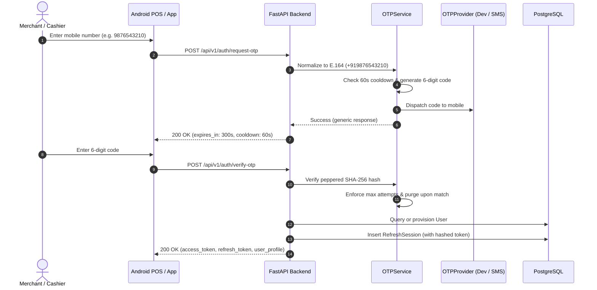

# DukaanAI — Authentication Architecture & OTP Workflow

## 1. Authentication Philosophy

Indian kirana merchants and store staff operate mobile-first. Password-based authentication introduces high friction, forgotten credentials, and counter billing delays.

DukaanAI implements **Passwordless Phone OTP Authentication** augmented by **Cryptographically Secure Rotating JWT Refresh Sessions**:

---

## 2. Phone Number Normalization

All phone numbers are normalized to the international **E.164** standard before processing:
- Input: `9876543210` $\to$ Normalized: `+919876543210`
- Input: `09876543210` $\to$ Normalized: `+919876543210`
- Input: `+91 98765 43210` $\to$ Normalized: `+919876543210`
- Invalid formats (e.g. non-numeric, fewer than 10 digits) fail immediately with HTTP 422 `VALIDATION_ERROR`.

---

## 3. Cryptographic Storage & OTP Security Guarantees

1. **Zero Plaintext Storage**: OTPs are never stored in plaintext in memory or database. They are hashed using a pepper-salted SHA-256 digest:
   $$\text{Hash} = \text{SHA256}(\text{phone} + \text{plain\_otp} + \text{OTP\_SECRET\_PEPPER})$$
2. **Constant-Time Comparison**: Verification uses `secrets.compare_digest` to prevent timing side-channel attacks.
3. **Attempt Limit Lockout**: Maximum 5 attempts per OTP code (`settings.OTP_MAX_ATTEMPTS`). Exceeding this limit purges the pending OTP and locks verification with HTTP 429 `OTP_MAX_ATTEMPTS_EXCEEDED`.
4. **Replay Attack Prevention**: Upon successful verification, the pending record is immediately destroyed. The same OTP code cannot be verified twice.
5. **Request Cooldown**: Enforces a 60-second throttling cooldown between consecutive OTP requests for the same mobile number.

---

## 4. OTP Provider Architecture

The delivery mechanism is abstracted via [`OTPProvider`](file:///c:/Dukan-AI/backend/app/infrastructure/otp/base.py):

- **[`DevOTPProvider`](file:///c:/Dukan-AI/backend/app/infrastructure/otp/dev_provider.py)**: Used during local development and automated CI testing. Captures codes in-memory, inspectable via test fixtures. Strictly blocked from instantiating when `ENVIRONMENT == 'production'`.
- **[`SmsOTPProvider`](file:///c:/Dukan-AI/backend/app/infrastructure/otp/sms_provider.py)**: Production gateway adapter for AWS SNS / DLT-compliant Indian telecom gateways.

---

## 5. Token Management & Refresh Session Rotation

1. **Short-Lived Access Token**:
   - Lifetime: 15 minutes.
   - Algorithm: `HS256`.
   - Claims: `sub` (User UUID), `session_id` (RefreshSession UUID), `jti` (Token UUID), `iat`, `exp`, `iss`, `aud`.
2. **Rotating Refresh Token**:
   - Lifetime: 30 days.
   - Format: 32-byte cryptographically secure random string (`secrets.token_urlsafe(32)`).
   - Storage: Stored only as SHA-256 digest in `refresh_sessions.token_hash`.
3. **Token Reuse Detection (Family Revocation)**:
   - When a refresh token is used, it is revoked (`revoked_at = now()`) and a new refresh token is issued.
   - If an already-revoked refresh token is presented (indicating a stolen token being replayed by an attacker), the backend detects the reuse and immediately revokes **all** active sessions for that user across all devices.
