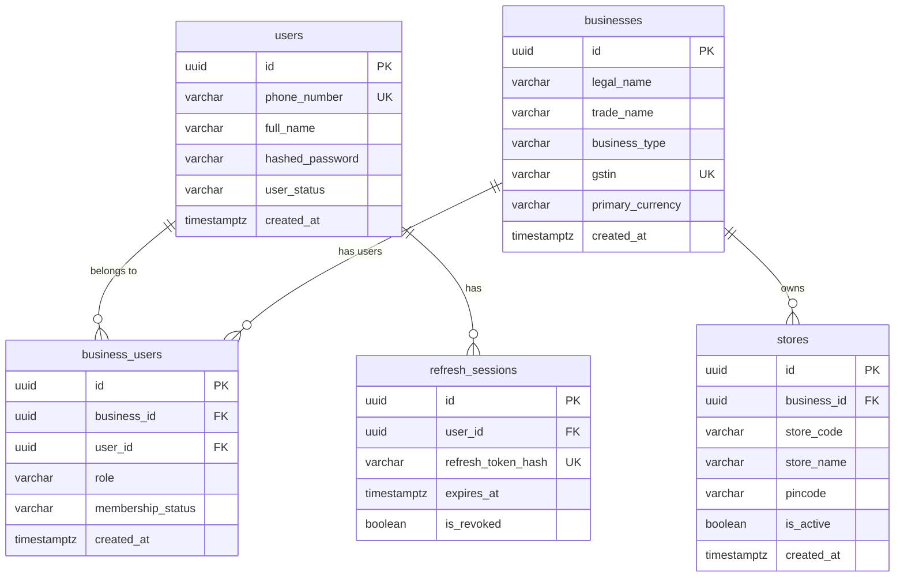
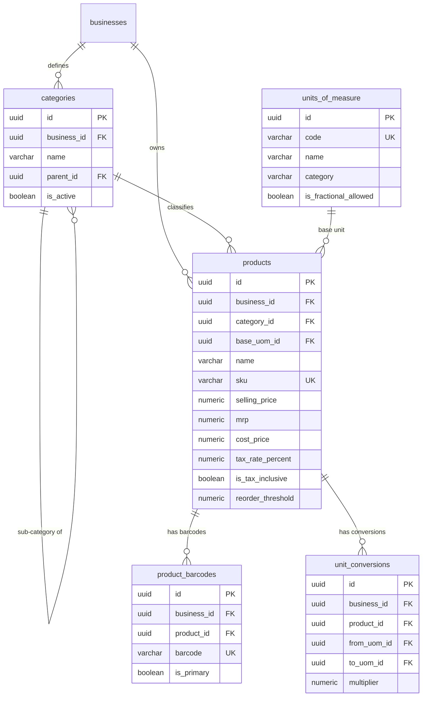
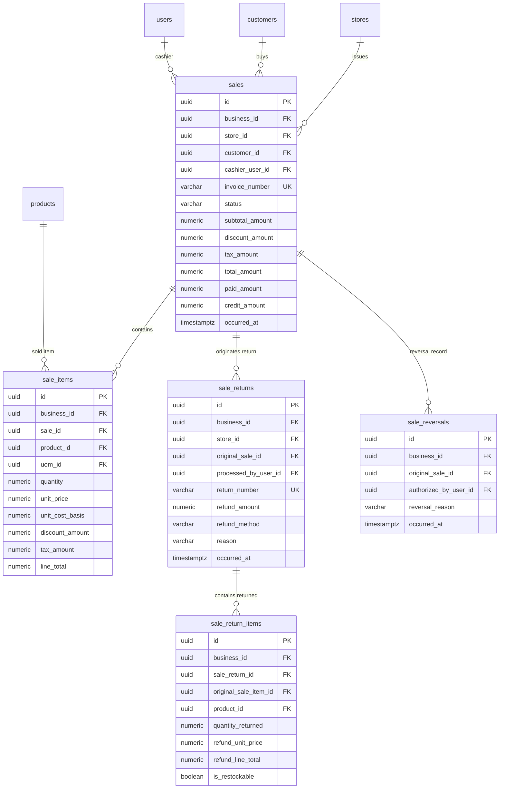
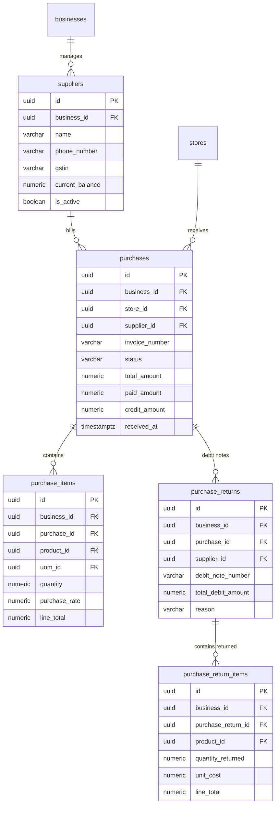
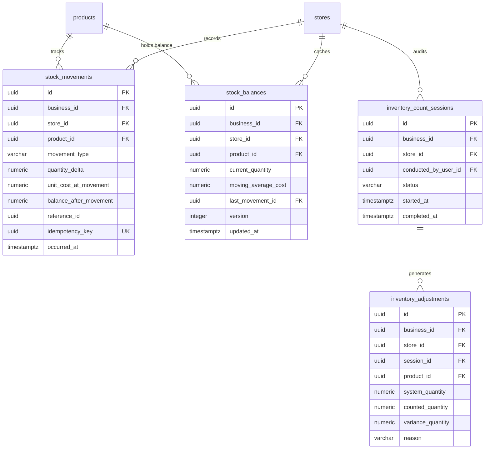
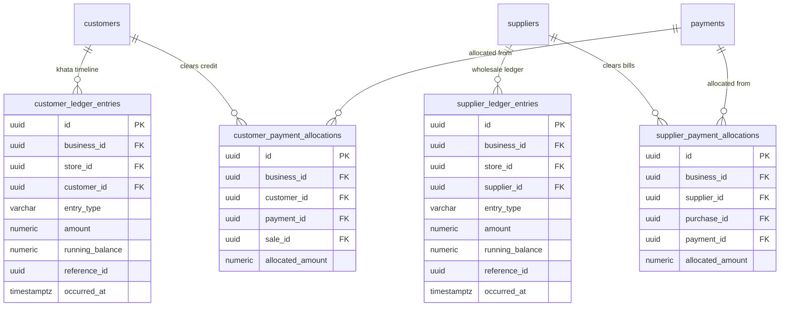
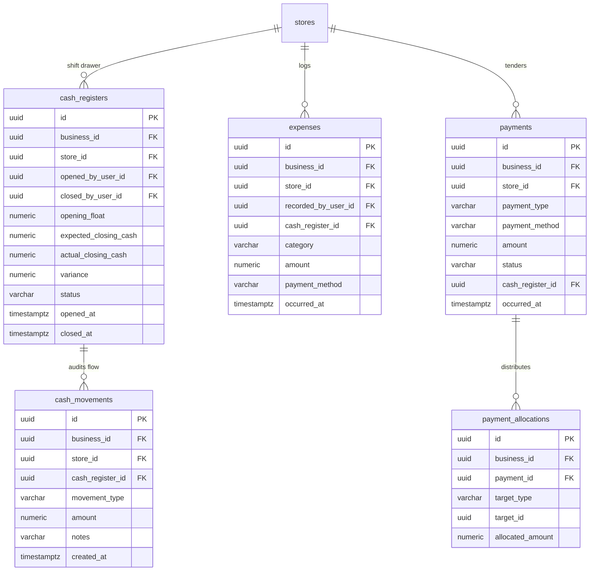
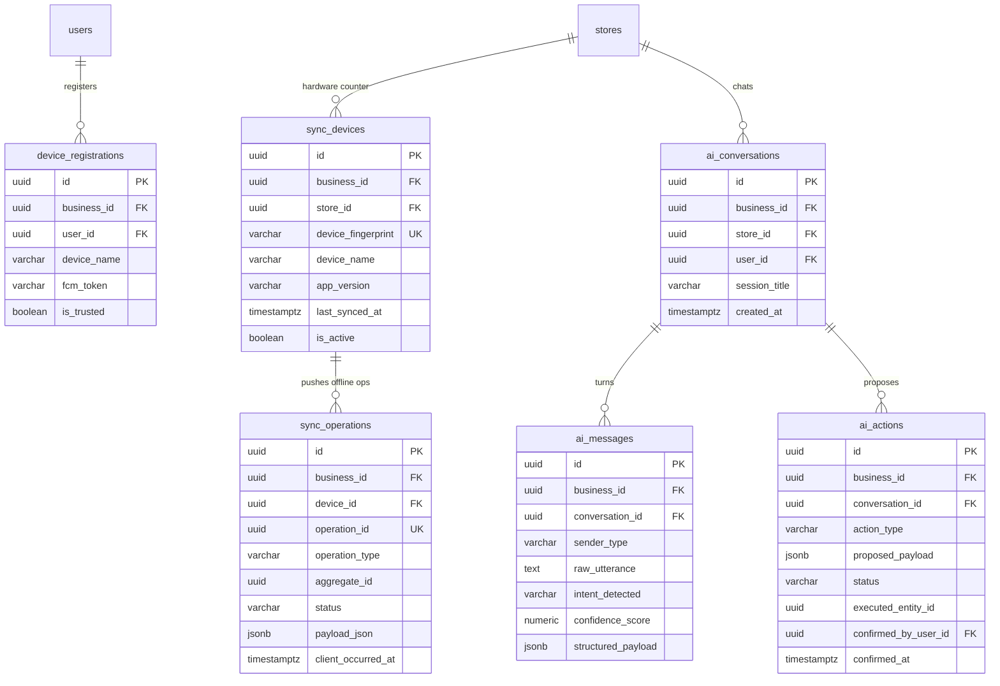

# DukaanAI — Entity-Relationship Diagrams

To ensure visual clarity and avoid oversized monolithic diagrams, the DukaanAI relational schema is partitioned into functional bounded context entity-relationship diagrams.

---

## 1. Identity & Business Hierarchy

---

## 2. Product Catalogue Context

---

## 3. Sales & Returns Context

---

## 4. Purchasing & Supplier Context

---

## 5. Inventory & Movements Context

---

## 6. Khata (Customer & Supplier Ledger) Context

---

## 7. Financial Management & Cash Register Context

---

## 8. Offline Synchronization & AI Assistant Context

