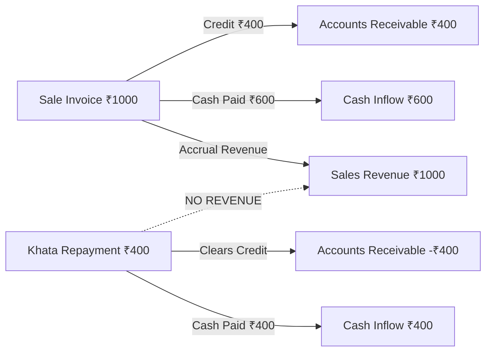

# DukaanAI — Financial Persistence & Cash Drawer Architecture

## 1. Core Accounting Model: Accrual vs Cash Flow

A common error in basic retail software is equating **Cash Inflow** with **Sales Revenue**. In Indian kirana stores where Udhar (customer credit) constitutes 20% to 50% of monthly transaction volume, this distinction is vital.

DukaanAI maintains strict separation between **Revenue Recognition** and **Cash Flow**:

- **Sales Revenue**: Recognized when goods are transferred to the customer (`sales.total_amount`), regardless of whether paid in cash, UPI, or credit.
- **Customer Khata Repayment**: An asset conversion. It increases cash/bank and reduces Accounts Receivable. It generates **zero** sales revenue.
- **Cost of Goods Sold (COGS)**: Recognized at the moment of sale based on the item's `unit_cost_basis`.

---

## 2. Cash Drawer (Galla) Management & Shifts

The store cash register (`cash_registers`) tracks the physical cash drawer across shifts:

### A. The Shift Lifecycle
1. **Opening Shift**:
   - Cashier counts morning cash float (e.g. ₹2,000 for change).
   - Inserts row into `cash_registers` with `opening_float = 2000.00` and `status = 'OPEN'`.
   - Inserts `cash_movements` (`movement_type = 'FLOAT_IN'`, `amount = 2000.00`).
2. **Operational Ingress & Egress**:
   - Every cash transaction appends an entry to `cash_movements`:
     - Cash sale tendered $\to$ `SALE_IN`
     - Khata repayment in cash $\to$ `KHATA_REPAYMENT_IN`
     - Cash expense paid (tea, electricity) $\to$ `EXPENSE_OUT`
     - Wholesale vendor paid in cash $\to$ `SUPPLIER_PAYOUT_OUT`
     - Mid-day cash drop to bank $\to$ `FLOAT_OUT`
3. **Closing Shift Reconciliation**:
   - Mathematical formula for expected cash:
     $$\text{Expected Cash} = \text{Opening Float} + \sum \text{Cash Inflows} - \sum \text{Cash Outflows}$$
   - The cashier physically counts the drawer and enters `actual_closing_cash`.
   - The system computes:
     $$\text{Variance} = \text{Actual Closing Cash} - \text{Expected Closing Cash}$$
   - If variance $\ne 0$, the cashier must enter a discrepancy explanation in `notes`.
   - The register status transitions to `'CLOSED'`.

---

## 3. Operating Expenses (`expenses`)

Store expenses are direct operational cash or bank outflows separate from inventory procurement:
- **Categories**: `RENT`, `ELECTRICITY`, `SALARY`, `MAINTENANCE`, `LOGISTICS`, `REFRESHMENTS` (chai/snacks), `OTHER`.
- **Cash Impact**: If `payment_method = 'CASH'`, it links to `cash_register_id` and automatically creates an `EXPENSE_OUT` movement in `cash_movements`.
- **Integrity**: Enforced by check constraint `chk_expense_amount_positive (amount > 0)`.

---

## 4. Universal Payments & Allocation Engine

To prevent tight coupling between payment tenders and specific business documents, payments are decoupled into two entities:

### `payments`
Represents the actual tender instrument used:
- `amount` (`NUMERIC(14, 2)`)
- `payment_method`: `CASH`, `UPI` (Google Pay, PhonePe, Paytm), `BANK_TRANSFER`, `CUSTOMER_CREDIT`
- `status`: `PENDING`, `SETTLED`, `FAILED`, `REFUNDED`, `REVERSED`
- `transaction_reference`: UPI UTR number or bank transaction ID.

### `payment_allocations`
Distributes the tender amount across one or more target obligations:
- `target_type`: `SALE`, `PURCHASE`, `CUSTOMER_ACCOUNT`, `EXPENSE`
- `target_id`: UUID of the linked document.
- `allocated_amount`: Sub-portion of payment applied to this target.

This design cleanly accommodates split payments (e.g. ₹500 sale paid ₹300 cash + ₹200 UPI) and lump-sum repayments (e.g. ₹2,000 UPI repayment covering three distinct past credit sales).
