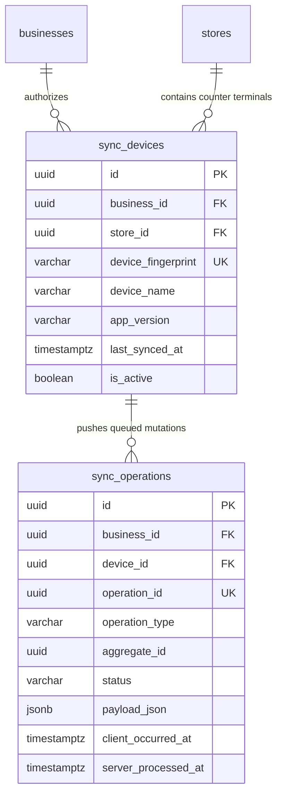
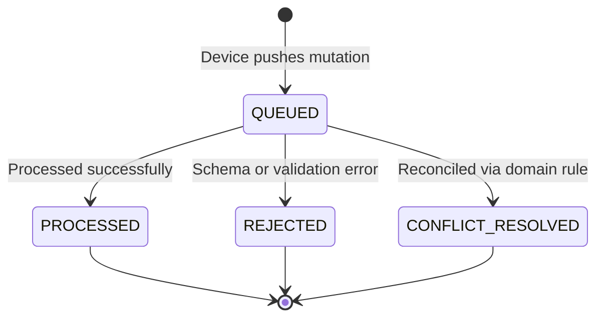

# DukaanAI — Offline Synchronization Persistence

## 1. Offline-First Synchronization Philosophy

Indian kirana shops frequently experience intermittent mobile connectivity, power cuts, or network congestion. An application that blocks counter billing while waiting for cloud round-trips is unusable in real-world retail.

DukaanAI is built on an **Offline-First, Cloud-Synchronized** foundation:
- The Android terminal is the primary operational write target for counter operations.
- Transactions are committed locally in Room (SQLite) instantly.
- Background WorkManager sync tasks stream batches of signed mutation operations to the backend when connectivity resumes.
- The PostgreSQL database acts as the central multi-device consistency hub and audit store.

---

## 2. Persistence Model for Synchronization

### Table Roles:
1. `sync_devices`: Tracks each physical tablet or smartphone terminal in a store, storing its hardware fingerprint and last successful synchronization timestamp.
2. `sync_operations`: An immutable queue and audit journal of all incoming client-side mutations. Stores the raw mutation payload in `JSONB` for replayability and conflict audit.
3. `idempotency_keys`: Central cache of HTTP request idempotency hashes preventing duplicate processing of HTTP requests during network dropouts.

---

## 3. Idempotency Key Guarantees

Every client mutation carries a client-generated UUID `idempotency_key`.

### Dual-Layer Deduplication:
1. **Database Constraint Level**:
   - `stock_movements` enforces `UNIQUE (business_id, idempotency_key)`.
   - `sync_operations` enforces `UNIQUE (device_id, operation_id)`.
   - If an Android terminal retransmits an operation after a network timeout, the database rejects duplicate insertion with a unique constraint violation.
2. **Application Gateway Level**:
   - The sync ingestion service checks `idempotency_keys`. If already present and processed, it immediately returns the cached HTTP 200 response without re-executing domain services.

---

## 4. Conflict Resolution Strategies

Different domain concepts require different conflict resolution policies:

| Domain Aggregate | Conflict Policy | Rationale |
|---|---|---|
| **POS Sales** (`sales`, `sale_items`) | **Append-Only / Independent** | Every sale generated by a cashier is a distinct physical transaction that actually occurred. Two offline sales never overwrite each other; both are ingested as valid distinct invoices. |
| **Stock Movements** (`stock_movements`) | **Algebraic Commutative** | Stock deltas are commutative: $S - \Delta_1 - \Delta_2 = S - \Delta_2 - \Delta_1$. Incoming movements are appended, and the cached balance is re-projected. |
| **Product Master Data** (`products`) | **Server-Authoritative / LWW** | Catalogue pricing edits made by the shop owner on the web or master terminal take precedence over background edge terminals using Last-Write-Wins based on server timestamp. |
| **Khata Repayments** | **Append-Only Ledger** | Customer payments are distinct physical tenders. They append to `customer_ledger_entries` and decrement the balance chronologically. |
| **Customer Profile** (`customers`) | **Field-Level Merge** | Non-conflicting edits (e.g. updating phone number on device A while updating credit limit on device B) are merged at the field level. |

---

## 5. Sync Operation Status Lifecycle

- `QUEUED`: Stored in `sync_operations`, pending domain transaction execution.
- `PROCESSED`: Applied cleanly to domain tables (`sales`, `stock_movements`, etc.).
- `CONFLICT_RESOLVED`: Applied after automated domain conflict resolution rules.
- `REJECTED`: Mutation violated hard invariants (e.g. invalid product ID, negative selling price); preserved in `sync_operations` for developer inspection and user alert.
