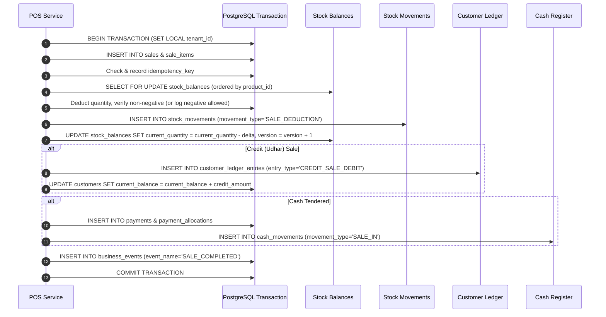

# DukaanAI — Transaction Design & Consistency Boundaries

## 1. Concurrency Model & Isolation Levels

DukaanAI operates on PostgreSQL **Read Committed** isolation level augmented by explicit row locking (`SELECT ... FOR UPDATE`) and **Optimistic Concurrency Control (OCC)** using entity version columns.

### Why Read Committed with Selective Locking?
1. **Throughput**: Avoids the serialization failure retry storm common in pure `SERIALIZABLE` mode under high POS transaction rates.
2. **Determinism**: Atomic multi-table updates are protected within explicit database transactions.
3. **Lock Ordering Discipline**: To completely prevent deadlocks during concurrent multi-item sales or bulk inventory receipts, rows across shared tables (`stock_balances`, `customers`, `suppliers`) are always acquired in deterministic order sorted by primary key UUID (`ORDER BY id`).

---

## 2. Core Transaction Workflows

### A. Point of Sale (POS) Transaction Completion
A single atomic transaction executes the entire POS checkout:



#### Atomicity Guarantees:
- If a stock deduction fails (or network disconnects), the invoice, stock delta, payment, and customer ledger updates roll back completely.
- Double-taps on the POS "Complete Sale" button are intercepted by `(business_id, idempotency_key)` uniqueness, returning the original response without executing duplicate stock deductions or credit additions.

---

### B. Wholesale Purchase Receipt & Cost Revaluation
When a wholesale delivery arrives at the store:

1. **Insert Purchase Invoice**: Records `purchases` header and line items in `purchase_items`.
2. **Lock Stock Balance**: `SELECT FOR UPDATE` on `stock_balances` for incoming products.
3. **Calculate Moving Average Cost (MAC)**:
   $$\text{New Cost} = \frac{(\text{Current Qty} \times \text{Current Cost}) + (\text{Received Qty} \times \text{Purchase Rate})}{\text{Current Qty} + \text{Received Qty}}$$
4. **Append Movement**: Insert into `stock_movements` with `movement_type = 'PURCHASE_RECEIPT'` and `quantity_delta = +received_qty`.
5. **Update Balance**: Update `stock_balances` with new quantity, new MAC, and `version = version + 1`.
6. **Update Supplier Liability**:
   - If credit purchase: Insert into `supplier_ledger_entries` (`entry_type = 'PURCHASE_LIABILITY_CREDIT'`) and increment `suppliers.current_balance`.
   - If cash/bank paid: Insert into `payments`, `payment_allocations`, and `cash_movements`.
7. **Publish Event**: Insert `PURCHASE_RECEIVED` into `business_events`.
8. **Commit**.

---

### C. Customer Khata Repayment
When a customer pays off past Udhar credit:

1. **Insert Payment**: Records `payments` tender (`amount`, `payment_method = 'CASH' | 'UPI'`).
2. **Append Ledger Entry**:
   - `INSERT INTO customer_ledger_entries`:
     - `entry_type = 'PAYMENT_CREDIT'`
     - `amount = repayment_amount`
     - `running_balance = previous_balance - repayment_amount`
3. **Update Balance Projection**:
   - `UPDATE customers SET current_balance = current_balance - repayment_amount`
4. **FIFO Allocation (Optional/Automated)**:
   - Queries oldest unpaid credit sales (`credit_amount > paid_amount`).
   - Inserts `customer_payment_allocations` linking repayment to specific sale invoices.
5. **Cash Drawer Ingress**:
   - If paid in cash, inserts `cash_movements` with `movement_type = 'KHATA_REPAYMENT_IN'`.
6. **Commit**.

> [!IMPORTANT]
> A customer repayment creates **zero sales revenue**. It is an asset conversion (Accounts Receivable $\to$ Cash/Bank). Revenue was recognized at the time of the original credit sale.

---

### D. Sale Reversal / Void
When a cashier makes a billing mistake and voids a completed invoice:

1. **Verify State**: Verify `sale.status == 'COMPLETED'` and no subsequent returns or settlements exist.
2. **Insert Reversal Record**: Insert into `sale_reversals` (`reversal_reason`, `authorized_by_user_id`).
3. **Update Sale Header**: Set `sales.status = 'VOIDED'`.
4. **Restock Movement**: Insert compensating `stock_movements` (`movement_type = 'AUDIT_ADJUSTMENT'`, `quantity_delta = +sold_quantity`).
5. **Restore Stock Balance**: Increment `stock_balances.current_quantity`.
6. **Reverse Financials**:
   - If cash was paid: Log compensating `cash_movements` (`movement_type = 'FLOAT_OUT'`).
   - If credit was logged: Log `customer_ledger_entries` (`entry_type = 'ADJUSTMENT_CREDIT'`) and decrement `customers.current_balance`.
7. **Commit**.

---

## 3. Deadlock Prevention Strategy

Deadlocks occur when two concurrent transactions attempt to lock the same resources in opposite orders. For example:
- **Transaction 1 (Sale A)**: Locks Product 1, then Product 2.
- **Transaction 2 (Sale B)**: Locks Product 2, then Product 1.

### The Strict Sorting Rule:
In any multi-row update or lock operation, application services must sort resource IDs alphabetically before issuing SQL statements:

```python
# Application service ensures deterministic lock acquisition
sorted_product_ids = sorted(cart_items.keys())

# Generates: SELECT * FROM stock_balances WHERE product_id IN (...) ORDER BY product_id FOR UPDATE
stmt = (
    select(StockBalance)
    .where(
        StockBalance.store_id == store_id,
        StockBalance.product_id.in_(sorted_product_ids)
    )
    .order_by(StockBalance.product_id)
    .with_for_update()
)
```
This guarantees that all concurrent transactions acquire row locks in identical sequential order, rendering cyclic deadlocks impossible.
