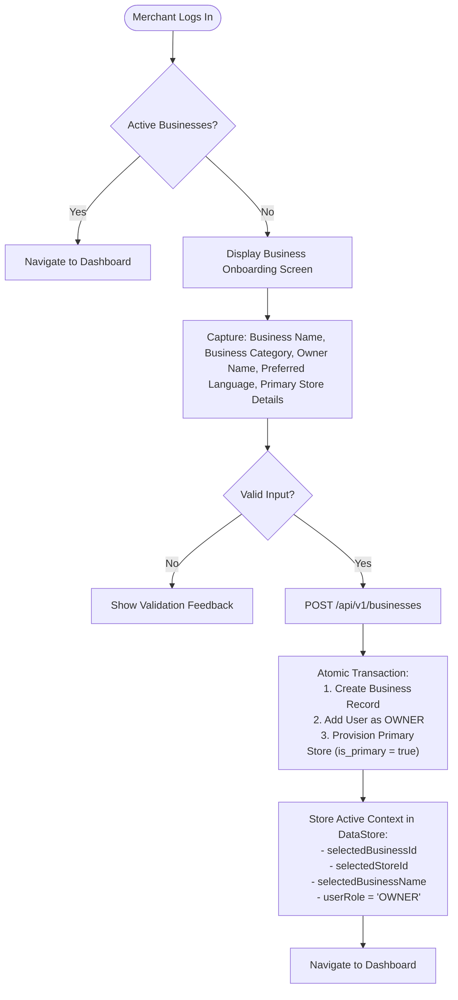

# DukaanAI — Business Onboarding Architecture

## 1. Overview
When a newly registered merchant completes OTP verification, DukaanAI inspects their business memberships. If the merchant has no business (`businesses.isEmpty()`), the application immediately initiates the business onboarding sequence.

---

## 2. Onboarding Workflow

---

## 3. Business Types & Categories
DukaanAI supports common Indian small retail formats:
- **GROCERY (किराना):** General FMCG, packed groceries, spices, grains.
- **GENERAL (जनरल स्टोर):** Stationery, toiletries, small household goods.
- **DAIRY (डेयरी):** Milk, curd, paneer, and perishables.
- **PHARMACY (दवाखाना):** Chemist and OTC healthcare.
- **OTHER:** Custom retail.
